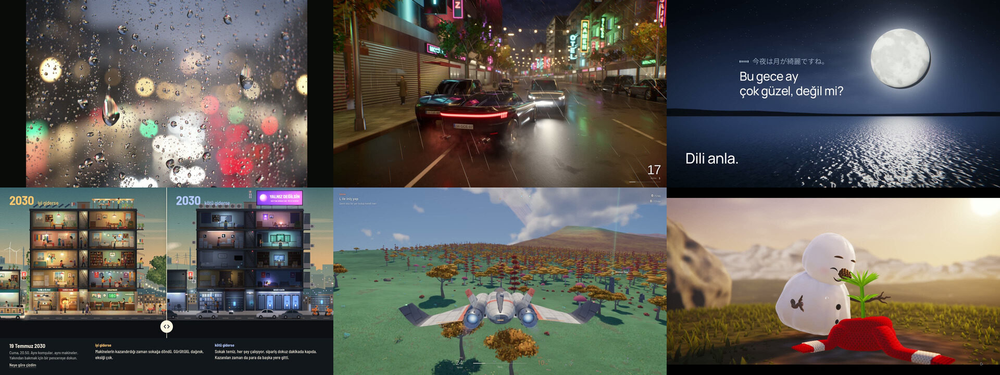
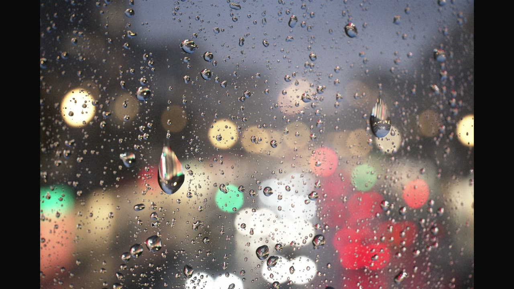
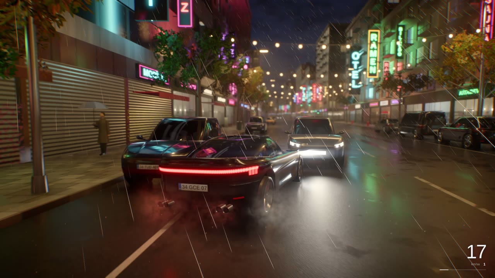
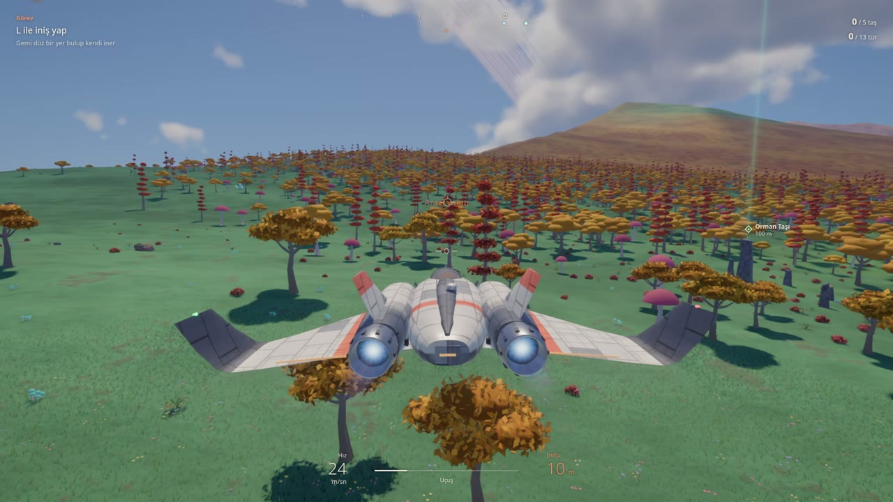
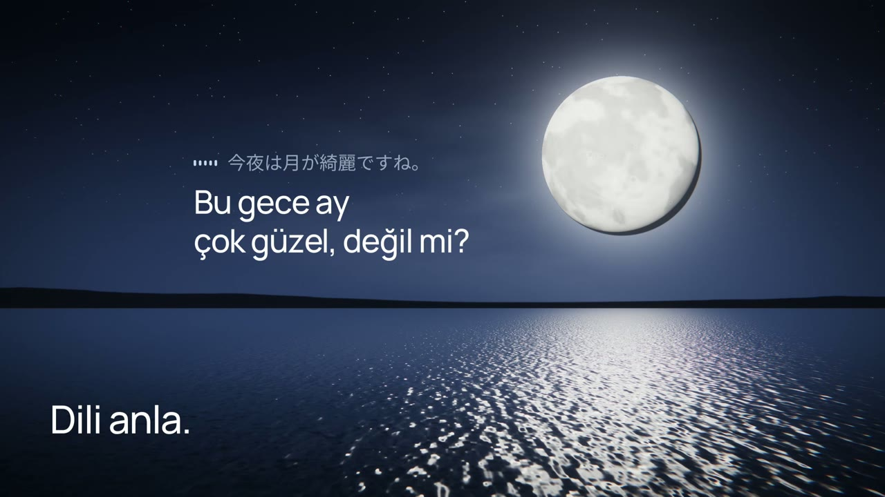
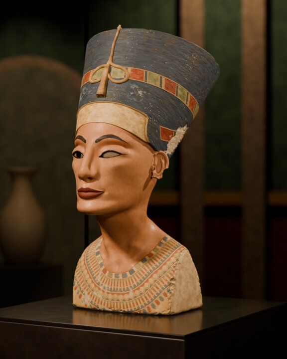
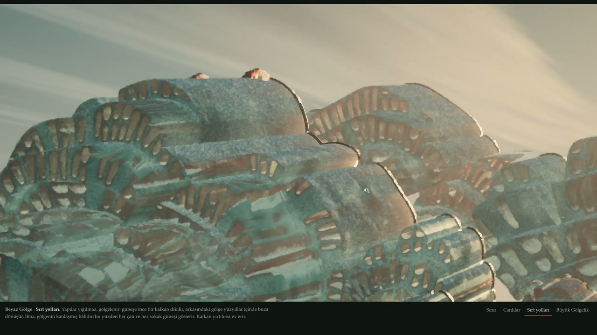
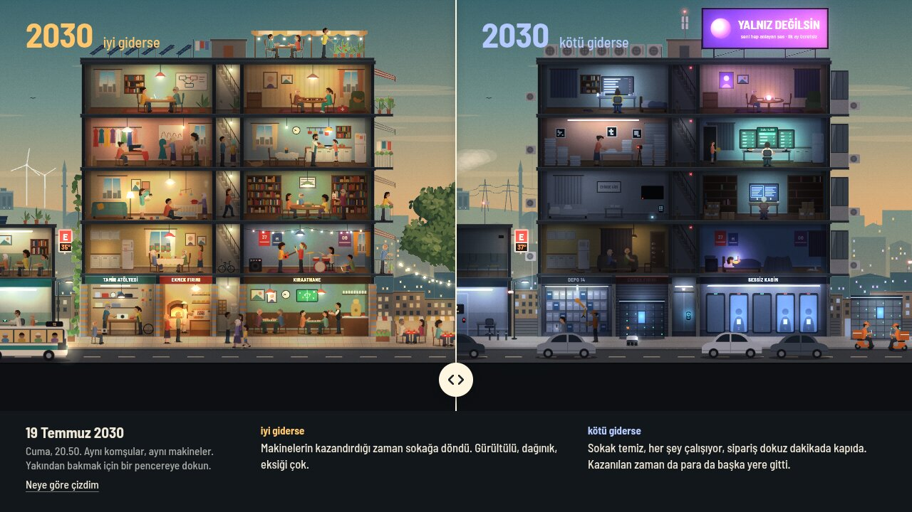
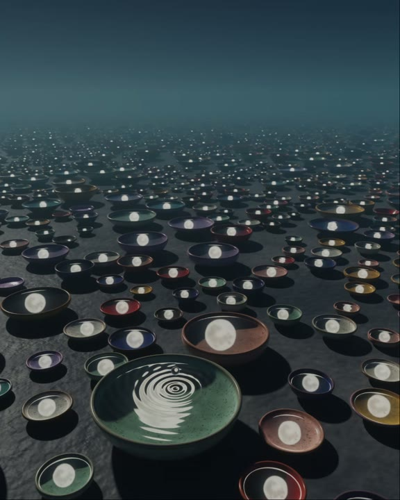

# Opus 5.6 testleri: on iş, her birine tek mesaj

Forn AI YouTube kanalının "Opus 5.6" videosunda gösterilen işlerin hepsi burada: modele verilen istemler birebir, modelin ürettiği HTML dosyaları, Blender render'ları ve kodları, filmler ve ekran kayıtları.

> **English summary:** Everything from our "Opus 5.6" video: the exact prompts, the single-file HTML works the model wrote (games, films, paintings, all code, no asset files), Blender renders and scripts, the model's own films, and clean frame-by-frame captures you are free to show in your own videos. The model was labelled "Opus 5.5" in Claude; Anthropic has not announced Opus 5.6.

**Video:** yayınlanınca buraya eklenecek.

**🎬 MP4'ler ve Blender sahneleri:** [doğrudan indirme bağlantıları](#videolar-blender-sahneleri-ve-ekran-kayıtları) · [Releases](https://github.com/fornhere/opus-5-6-testleri/releases/tag/v1.0)

## Önce şunu bilin

- **Opus 5.6 resmî olarak duyurulmadı.** 24 Kasım 2026'dan beri bazı Claude kullanıcıları, seçicide "Opus 5.5" yazarken cevabı daha yeni bir modelin verdiğini söylüyor. Bu işler o sırada, Claude'da Opus 5.5 seçiliyken yapıldı. Oturum kayıtlarında model kimliği `claude-opus-5-5` görünüyor; `claude-opus-5-6` diye bir kimlik hiçbir yerde geçmiyor.
- Yani bu depo "Opus 5.6 kesin budur" demiyor. Modelin adını değil, ne yaptığını gösteriyor; kararı işlere bakarak siz verin.

## İşler

Süreler ve maliyetler oturum kayıtlarından. On iş **aynı anda, aynı ekran kartında (RTX 5060)** koştu, bu yüzden süreler şişkin. $ = harcanan tokenların API liste fiyatıyla karşılığı; işler abonelikle koştu, bu para ayrıca ödenmedi.

| # | İş | Ne istendi | Mesaj | Süre | ≈ $ | Dosyalar |
|---|---|---|---|---|---|---|
| 01 | Yağmurlu Cam | Yalnız kodla fotoğraf gibi bir kare | 1 | 17 dk | 3,7 | [index.html](isler/01-yagmurlu-cam/index.html) |
| 02 | Çay | Blender'da sıfırdan fotogerçekçi kare | 1 (+1 film) | 2 sa 18 dk (+ film 4 sa 11 dk) | 10,2 (+7,9) | [kare](isler/02-cay/cay-karesi.png), [ilk ve son render](isler/02-cay/ilk-ve-son-render.jpg), [kod](isler/02-cay/kod/) |
| 03 | Gece Yağmuru | Three.js ile yağmurlu gece sürüş oyunu | 1 | 52 dk | 16,5 | [index.html](isler/03-gece-yagmuru/index.html) |
| 04 | Tanyeli | Yörüngeden yüzeye kesintisiz gezegen oyunu | 1 | 63 dk | 13,9 | [index.html](isler/04-tanyeli/index.html) |
| 05 | Halo | Uydurma akıllı gözlüğe 30 sn lansman filmi | 1 | 49 dk | 10,8 | [index.html](isler/05-halo/index.html) |
| 06 | Gölge | Diyalogsuz 1 dk kısa animasyon | 1 | 49 dk | 12,6 | [index.html](isler/06-golge/index.html) |
| 07 | Nefertiti | Blender'da sıfırdan ikonik bir heykel | 1 (+1 film) | 82 dk (+ film 2 sa 28 dk) | 8,7 (+10,3) | [render](isler/07-nefertiti/nefertiti-bust.png), [kod](isler/07-nefertiti/kod/) |
| 08 | Eşik | "Yapabileceğin en güçlü 3D çıktı" | birkaç, bir kez yön verildi | ≈5 sa, render dahil | 8,1 | [kod](isler/08-esik/kod/) |
| 09 | Beyaz Gölge | Yalnız kodla bir uzaylı medeniyeti | 1 | 38 dk | 6,2 | [index.html](isler/09-beyaz-golge/index.html) |
| 10 | 2030 | Aynı yerin iyi ve kötü 2030'u | 1 | 30 dk | 7,2 | [index.html](isler/10-2030/index.html) |
| 11 | Otoportre | "Kendini nasıl hayal ediyorsan çiz" | 1 (+1 soru) | 12 dk | 2,6 | [index.html](isler/11-otoportre/index.html), [modelin açıklaması](isler/11-otoportre/ACIKLAMA.md) |

İstemlerin hepsi birebir: [istemler/ISTEMLER.md](istemler/ISTEMLER.md). Eşik 24 Kasım akşamı ayrı koştu (effort high); öbür on iş 25 Kasım sabahı başladı (effort xhigh).

| | | |
|---|---|---|
|  Yağmurlu Cam |  Çay |  Gece Yağmuru |
|  Tanyeli |  Halo |  Gölge |
|  Nefertiti |  Eşik |  Beyaz Gölge |
|  2030 |  Otoportre | |

## Nasıl açılır

**Tarayıcıda hemen aç:** [Yağmurlu Cam](https://fornhere.github.io/opus-5-6-testleri/isler/01-yagmurlu-cam/) · [Gece Yağmuru (oyun)](https://fornhere.github.io/opus-5-6-testleri/isler/03-gece-yagmuru/) · [Tanyeli (oyun)](https://fornhere.github.io/opus-5-6-testleri/isler/04-tanyeli/) · [Halo (film)](https://fornhere.github.io/opus-5-6-testleri/isler/05-halo/) · [Gölge (film)](https://fornhere.github.io/opus-5-6-testleri/isler/06-golge/) · [Beyaz Gölge](https://fornhere.github.io/opus-5-6-testleri/isler/09-beyaz-golge/) · [2030](https://fornhere.github.io/opus-5-6-testleri/isler/10-2030/) · [Otoportre](https://fornhere.github.io/opus-5-6-testleri/isler/11-otoportre/)

HTML işlerinin her biri tek dosya: görsel, model, doku, ses ya da dış kütüphane dosyası yok, her şey kodla üretiliyor. İndirip tarayıcıda açmanız yeterli. Oyunlar ve filmler masaüstü Chrome'da denendi; WebGL isteyenler güçlü bir ekran kartında daha akıcı oynar.

Blender işlerinde (Çay, Nefertiti, Eşik) `kod/` klasöründeki Python betikleri sahneyi sıfırdan kuran kodlardır. Betiklerdeki yollar modelin kendi çalışma klasörüne göredir.

## Videolar, Blender sahneleri ve ekran kayıtları

Tıklayınca iner. Hepsi bir arada: [Releases v1.0](https://github.com/fornhere/opus-5-6-testleri/releases/tag/v1.0).

### Temiz kayıtlar

İşlerin kendi dosyalarından kare kare render edildi, ekran kaydı değil: 2560x1440 ve üstü, arayüz yok, kare düşmesi yok. Halo ve Gölge'de filmin kendi sesi var, diğerleri sessiz. Gece Yağmuru'ndaki son iki klip oyunun zayıf yanlarını da gösteriyor.

| İş | Klip | Ne | Boyut |
|---|---|---|---|
| Yağmurlu Cam | [cam-surec.mp4](https://github.com/fornhere/opus-5-6-testleri/releases/download/v1.0/cam-surec.mp4) | Kare ışın ışın birikirken: gürültüden temiz kareye | 87 MB |
| Gece Yağmuru | [gece-takip-yagmur-kirmizi.mp4](https://github.com/fornhere/opus-5-6-testleri/releases/download/v1.0/gece-takip-yagmur-kirmizi.mp4) | Takip kamerası, kırmızı araba, sağanak | 140 MB |
| Gece Yağmuru | [gece-alcak-turuncu-ciseleme.mp4](https://github.com/fornhere/opus-5-6-testleri/releases/download/v1.0/gece-alcak-turuncu-ciseleme.mp4) | Alçak takip, turuncu araba, çiseleme | 87 MB |
| Gece Yağmuru | [gece-kaput-yagmur.mp4](https://github.com/fornhere/opus-5-6-testleri/releases/download/v1.0/gece-kaput-yagmur.mp4) | Kaput kamerası, camda damlalar, neon yansımaları | 155 MB |
| Gece Yağmuru | [gece-sinema-gecis-petrol.mp4](https://github.com/fornhere/opus-5-6-testleri/releases/download/v1.0/gece-sinema-gecis-petrol.mp4) | Sinema kamerası, araba kameranın yanından geçiyor | 60 MB |
| Gece Yağmuru | [gece-sinema-yorunge-gumus.mp4](https://github.com/fornhere/opus-5-6-testleri/releases/download/v1.0/gece-sinema-yorunge-gumus.mp4) | Dükkânların önünden ağır geçiş, sağanak | 91 MB |
| Gece Yağmuru | [gece-takip-yagmursuz-siyah.mp4](https://github.com/fornhere/opus-5-6-testleri/releases/download/v1.0/gece-takip-yagmursuz-siyah.mp4) | Takip, yağmur dinmiş, kuru asfalt | 51 MB |
| Gece Yağmuru | [gece-dukkan-yakin.mp4](https://github.com/fornhere/opus-5-6-testleri/releases/download/v1.0/gece-dukkan-yakin.mp4) | Dükkân vitrinleri yakından (insanlar düz siluet) | 36 MB |
| Gece Yağmuru | [gece-insan-yakin.mp4](https://github.com/fornhere/opus-5-6-testleri/releases/download/v1.0/gece-insan-yakin.mp4) | Yayanın çevresinde dönüş (yüzsüz figür) | 71 MB |
| Tanyeli | [tanyeli-yorunge-inis.mp4](https://github.com/fornhere/opus-5-6-testleri/releases/download/v1.0/tanyeli-yorunge-inis.mp4) | Yörüngeden yüzeye kesintisiz iniş | 142 MB |
| Tanyeli | [tanyeli-yorunge-inis-acik.mp4](https://github.com/fornhere/opus-5-6-testleri/releases/download/v1.0/tanyeli-yorunge-inis-acik.mp4) | Yörüngeden iniş, ikinci çekim | 127 MB |
| Tanyeli | [tanyeli-gece-yuruyus.mp4](https://github.com/fornhere/opus-5-6-testleri/releases/download/v1.0/tanyeli-gece-yuruyus.mp4) | Gece yürüyüşü, fener, parlayan mantarlar | 68 MB |
| Tanyeli | [tanyeli-gece-tas.mp4](https://github.com/fornhere/opus-5-6-testleri/releases/download/v1.0/tanyeli-gece-tas.mp4) | Fısıltı Taşı: harfler yanıyor | 47 MB |
| Tanyeli | [tanyeli-gece-halka.mp4](https://github.com/fornhere/opus-5-6-testleri/releases/download/v1.0/tanyeli-gece-halka.mp4) | Gece gökyüzü: gezegen halkası ve kutup ışıkları | 49 MB |
| Halo | [halo.mp4](https://github.com/fornhere/opus-5-6-testleri/releases/download/v1.0/halo.mp4) | 30 sn film baştan sona, filmin kendi sesiyle | 317 MB |
| Gölge | [golge.mp4](https://github.com/fornhere/opus-5-6-testleri/releases/download/v1.0/golge.mp4) | 60 sn film baştan sona, filmin kendi sesiyle (2:1) | 686 MB |
| Çay | [cay-3b-yorunge-kati.mp4](https://github.com/fornhere/opus-5-6-testleri/releases/download/v1.0/cay-3b-yorunge-kati.mp4) | Bardak, simit, şeker çevresinde dönüş (katı) | 11 MB |
| Çay | [cay-3b-yorunge-tel.mp4](https://github.com/fornhere/opus-5-6-testleri/releases/download/v1.0/cay-3b-yorunge-tel.mp4) | Aynı dönüş, tel kafes | 67 MB |
| Çay | [cay-3b-oda-kati.mp4](https://github.com/fornhere/opus-5-6-testleri/releases/download/v1.0/cay-3b-oda-kati.mp4) | Dışarıdan odaya girip bardağa ilerleme (katı) | 10 MB |
| Çay | [cay-3b-oda-katitel.mp4](https://github.com/fornhere/opus-5-6-testleri/releases/download/v1.0/cay-3b-oda-katitel.mp4) | Aynı yol, katı + tel kafes | 24 MB |
| Çay | [cay-3b-makro-kati.mp4](https://github.com/fornhere/opus-5-6-testleri/releases/download/v1.0/cay-3b-makro-kati.mp4) | Küp şekerden simidin susamına makro (katı) | 13 MB |
| Çay | [cay-3b-makro-katitel.mp4](https://github.com/fornhere/opus-5-6-testleri/releases/download/v1.0/cay-3b-makro-katitel.mp4) | Aynı makro, katı + tel kafes | 47 MB |
| Nefertiti | [nefertiti-3b-yorunge-kati.mp4](https://github.com/fornhere/opus-5-6-testleri/releases/download/v1.0/nefertiti-3b-yorunge-kati.mp4) | Büstün çevresinde 300° dönüş (katı) | 12 MB |
| Nefertiti | [nefertiti-3b-yorunge-tel.mp4](https://github.com/fornhere/opus-5-6-testleri/releases/download/v1.0/nefertiti-3b-yorunge-tel.mp4) | Aynı dönüş, tel kafes | 54 MB |
| Nefertiti | [nefertiti-3b-yorunge-malzeme.mp4](https://github.com/fornhere/opus-5-6-testleri/releases/download/v1.0/nefertiti-3b-yorunge-malzeme.mp4) | Aynı dönüş, malzeme önizlemesi | 18 MB |
| Nefertiti | [nefertiti-3b-makro-kati.mp4](https://github.com/fornhere/opus-5-6-testleri/releases/download/v1.0/nefertiti-3b-makro-kati.mp4) | Yüz, kulak ve taç makrosu (katı) | 9 MB |
| Nefertiti | [nefertiti-3b-makro-katitel.mp4](https://github.com/fornhere/opus-5-6-testleri/releases/download/v1.0/nefertiti-3b-makro-katitel.mp4) | Aynı makro, katı + tel kafes | 109 MB |
| Nefertiti | [nefertiti-3b-muze-kati.mp4](https://github.com/fornhere/opus-5-6-testleri/releases/download/v1.0/nefertiti-3b-muze-kati.mp4) | Yüzden geri çekilip bütün müze sahnesi | 8 MB |
| Beyaz Gölge | [beyaz-golge-1-sinir-surec.mp4](https://github.com/fornhere/opus-5-6-testleri/releases/download/v1.0/beyaz-golge-1-sinir-surec.mp4) | 1. levha kendi kendine çizilirken | 22 MB |
| Beyaz Gölge | [beyaz-golge-2-canlilar-surec.mp4](https://github.com/fornhere/opus-5-6-testleri/releases/download/v1.0/beyaz-golge-2-canlilar-surec.mp4) | 2. levha (canlılar) çizilirken | 26 MB |
| Beyaz Gölge | [beyaz-golge-3-sirt-yollari-surec.mp4](https://github.com/fornhere/opus-5-6-testleri/releases/download/v1.0/beyaz-golge-3-sirt-yollari-surec.mp4) | 3. levha (sırt yolları) çizilirken | 17 MB |
| Beyaz Gölge | [beyaz-golge-4-buyuk-golgelik-surec.mp4](https://github.com/fornhere/opus-5-6-testleri/releases/download/v1.0/beyaz-golge-4-buyuk-golgelik-surec.mp4) | 4. levha (büyük gölgelik) çizilirken | 15 MB |
| Otoportre | [otoportre-surec.mp4](https://github.com/fornhere/opus-5-6-testleri/releases/download/v1.0/otoportre-surec.mp4) | Otoportre kendi kendine çizilirken | 13 MB |

### Modelin filmleri ve Blender sahneleri

| Tür | İş | İndir | Boyut |
|---|---|---|---|
| Modelin filmi | Çay | [model-02-cay-filmi.mp4](https://github.com/fornhere/opus-5-6-testleri/releases/download/v1.0/model-02-cay-filmi.mp4) | 14 sn, 70 MB |
| Modelin filmi | Nefertiti | [model-07-nefertiti-filmi.mp4](https://github.com/fornhere/opus-5-6-testleri/releases/download/v1.0/model-07-nefertiti-filmi.mp4) | 28 sn, 182 MB |
| Modelin filmi | Eşik | [model-08-esik-filmi.mp4](https://github.com/fornhere/opus-5-6-testleri/releases/download/v1.0/model-08-esik-filmi.mp4) | 48 sn, 154 MB |
| Blender sahnesi | Çay | [model-02-cay-sahnesi.blend](https://github.com/fornhere/opus-5-6-testleri/releases/download/v1.0/model-02-cay-sahnesi.blend) | 38 MB |
| Blender sahnesi | Nefertiti büst | [model-07-nefertiti-bust-sahnesi.blend](https://github.com/fornhere/opus-5-6-testleri/releases/download/v1.0/model-07-nefertiti-bust-sahnesi.blend) | 151 MB |
| Blender sahnesi | Nefertiti filmi | [model-07-nefertiti-filmi-sahnesi.blend](https://github.com/fornhere/opus-5-6-testleri/releases/download/v1.0/model-07-nefertiti-filmi-sahnesi.blend) | 177 MB |

**Kendi videonuzda gösterebilirsiniz.** Bu depodaki görselleri, filmleri ve ekran kayıtlarını kendi içeriğinizde kullanabilirsiniz; kaynak olarak Forn AI'ı anmanız yeterli.

## Lisans

Kod (HTML işler ve betikler): [MIT](LICENSE). Görseller, filmler, kayıtlar ve Blender sahneleri: [CC BY 4.0](https://creativecommons.org/licenses/by/4.0/deed.tr), kaynak: Forn AI.

## Koşullar

- Claude Code (masaüstü uygulaması), seçili model Opus 5.5.
- Her işe ayrı sohbet. Hiçbirinde skill kullanılmadı. Çay oturumu kendi karesini değerlendirmek için 4 kez alt ajan açtı.
- Kanal sahibinin kendi genel kuralları ve hafıza notları açıktı; bazı işler eski notlara baktı.
- Nefertiti'de model heykeli kendisi seçti ve Wikimedia'daki fotoğraflarına tarayıcıda baktı; hazır model ya da doku indirmedi.
